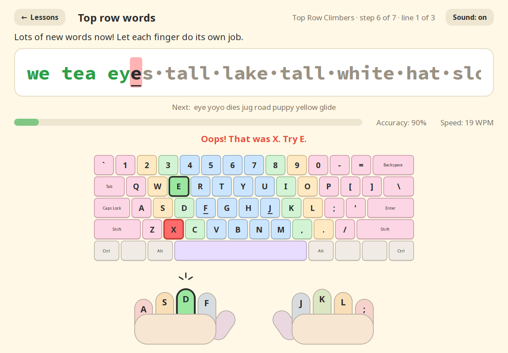
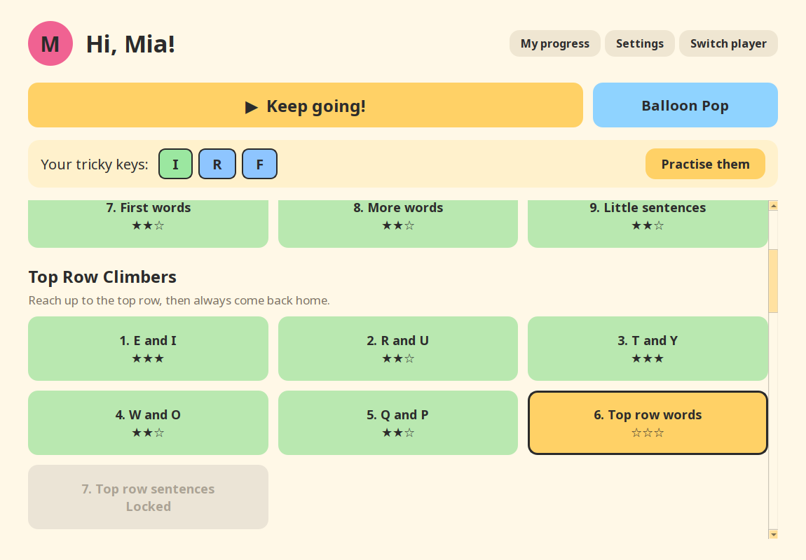
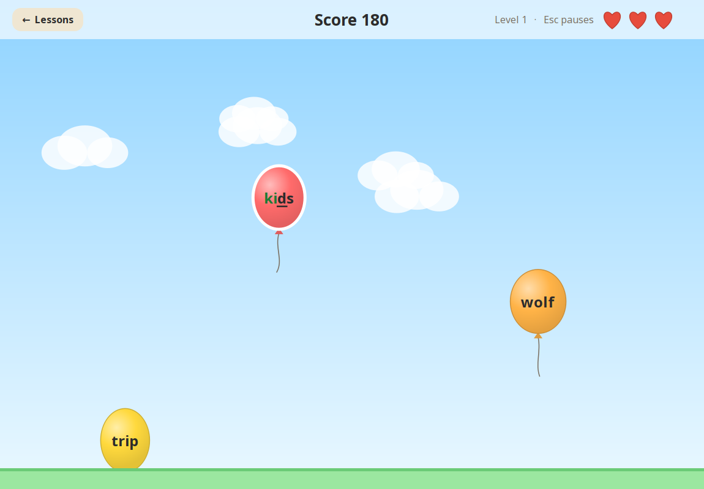
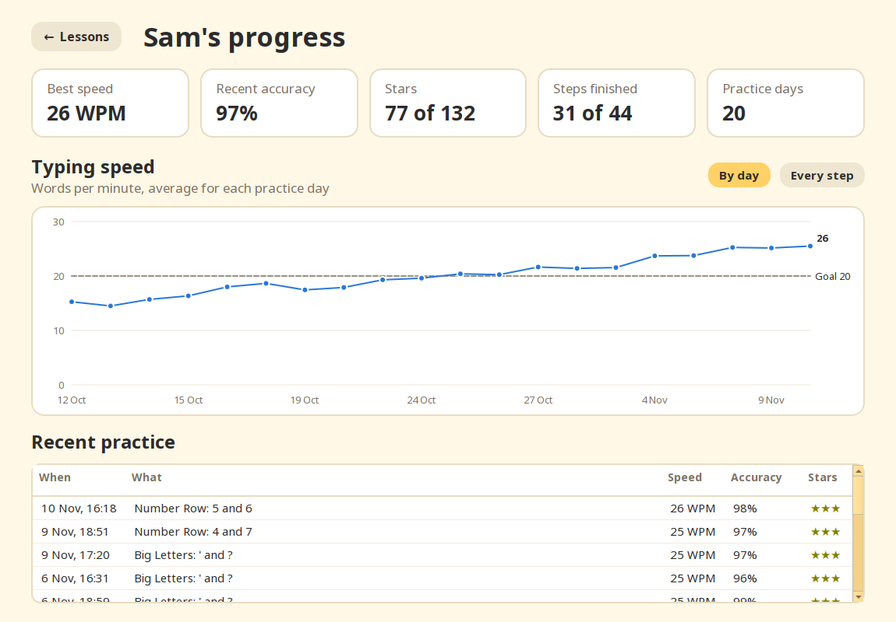
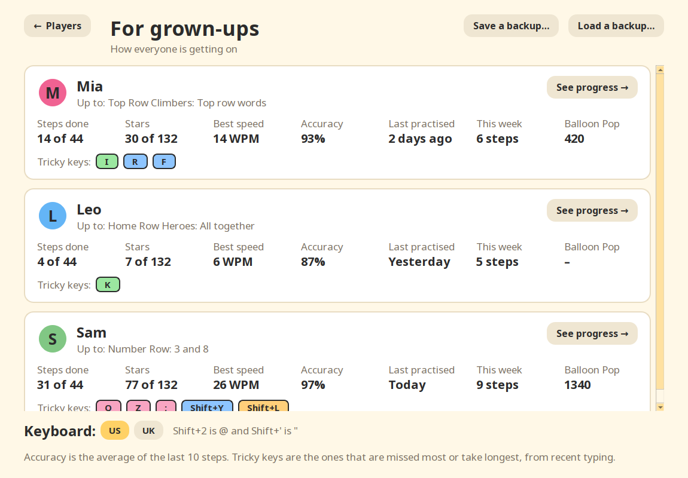

# Learn Typing

A friendly touch-typing tutor for kids, built with PySide6.

**Website:** https://mcvmcv.github.io/typing-tutor/

<p align="center">
  
</p>

<table>
  <tr>
    <td></td>
    <td></td>
  </tr>
  <tr>
    <td align="center">Lessons, stars and tricky keys</td>
    <td align="center">Balloon Pop</td>
  </tr>
  <tr>
    <td></td>
    <td></td>
  </tr>
  <tr>
    <td align="center">Progress chart</td>
    <td align="center">For grown-ups</td>
  </tr>
</table>

## Download and play

No Python needed. Download the app for your computer:

- **Windows:** [LearnTyping-windows.exe](https://github.com/mcvmcv/typing-tutor/releases/latest/download/LearnTyping-windows.exe)
- **Mac with Apple chip (M1 or newer):** [LearnTyping-macos-apple-silicon.zip](https://github.com/mcvmcv/typing-tutor/releases/latest/download/LearnTyping-macos-apple-silicon.zip)
- **Mac with Intel chip:** [LearnTyping-macos-intel.zip](https://github.com/mcvmcv/typing-tutor/releases/latest/download/LearnTyping-macos-intel.zip)
- **Linux:** [LearnTyping-linux.tar.gz](https://github.com/mcvmcv/typing-tutor/releases/latest/download/LearnTyping-linux.tar.gz)

The app isn't signed with a paid developer certificate, so the first time you
open it Windows or macOS will warn you. On Windows, click **More info → Run
anyway**. On a Mac, open **System Settings → Privacy & Security** and click
**Open Anyway**. See the [latest release](https://github.com/mcvmcv/typing-tutor/releases/latest)
for details.

## Install with Python

You need **Python 3.12 or newer** (check with `python3 --version`).

**With pipx:** install it straight from GitHub with
[pipx](https://pipx.pypa.io/), then start it:

```bash
pipx install git+https://github.com/mcvmcv/typing-tutor.git
learn-typing
```

**From a clone (Linux / macOS):**

```bash
git clone https://github.com/mcvmcv/typing-tutor.git
cd typing-tutor
make install   # first time only: creates .venv with the app and dev tools
make run       # or: .venv/bin/learn-typing
```

**From a clone (Windows, no `make`):**

```bat
git clone https://github.com/mcvmcv/typing-tutor.git
cd typing-tutor
python -m venv .venv
.venv\Scripts\pip install -e .
.venv\Scripts\learn-typing
```

Progress is saved per player in `profiles.json`, separately from the app, so
updating keeps everyone's stars:

- **Linux:** `~/.local/share/learn-typing/`
- **macOS:** `~/Library/Application Support/learn-typing/`
- **Windows:** `%APPDATA%\learn-typing\`

## Course

44 steps in 7 lessons: Home Row Heroes, Top Row Climbers, Bottom Row Divers,
Big Letters (Shift, ' and ?), Number Row, Punctuation Pros (! " - and :), and
Story Time. Where a key is somewhere else on a UK keyboard (`"`), the step
explains it for that keyboard. Each step is a few
lines; after any hand-written lines, the rest are generated fresh each play
using only keys learned so far.

## Tricky keys and speed goals

Every keystroke is tracked per key (misses and time taken, weighted toward
recent sessions). Once there's enough data, the lesson menu shows each
player's trickiest keys with a "Practise them" button for a focused drill.

Each player can have a speed goal (set when created, or via Settings). With a
goal, 3 stars needs both 95%+ accuracy and the target speed (75% of it on
key-drill steps). It's off by default, which suits young beginners.

## Balloon Pop

A typing game on the lesson menu, unlocked after the home row's "All
together" step. Words on balloons float up; type a word to pop its balloon,
and don't let 3 float away. It speeds up every 8 pops. Words only use keys the
player has learned. Easy/Medium/Hard set the starting speed and word length,
best scores are kept per difficulty, and game keystrokes feed the tricky-keys
stats. Esc pauses.

## Sounds

Soft synthesised sound effects (key tick, gentle "oops", line chime, star
fanfare) are generated on first run into the user's cache folder (e.g.
`~/.cache/learn-typing/` on Linux). Each
player can turn sounds or just key clicks off in Settings, or use the
Sound button on the practice screen.

## Typing line

Upcoming spaces in the line being typed show as faint centred dots ( · ) so
they aren't missed. Each player can turn the dots off in Settings; the
highlighted cursor still shows when a space is next.

## Progress screen

"My progress" on the lesson menu shows best speed, recent accuracy, stars,
steps finished and practice days, a speed chart (by day or every step, with the
speed goal as a dashed line; hover a point for details), and a table of recent
practice.

## For grown-ups

"For grown-ups" on the player picker shows every player side by side: where
they're up to, steps and stars, best speed, recent accuracy, when they last
practised, steps this week, best Balloon Pop score and tricky keys. "See
progress" opens a player's full progress screen without switching player.

**Backups:** "Save a backup…" writes everyone's progress to one file. "Load a
backup…" brings players in from a backup, e.g. on a new computer. The file is
checked first, so a wrong or damaged file is refused with an explanation. New
players are added (renamed, e.g. "Mia 2", if the name is taken), and if a
player is already here it asks before replacing their progress.

**Keyboard:** pick **US** or **UK** to match the computer's keyboard. The
on-screen keyboard and finger hints follow it (on UK: the tall Enter, `#` by
Enter, `\` by the left Shift, `"` on Shift+2 and `@` on Shift+'). Until you
choose, it's guessed from the computer's region (UK in the UK and Ireland,
otherwise US). The keys the course teaches are in the same place on both, so
the lessons are the same.

## Data

Everything is stored in one JSON file (path above), saved atomically. A backup
file has the same format, and a copy of `profiles.json` also loads as a backup. If it
ever can't be read, it's renamed to `profiles.broken-<time>.json` rather than
overwritten.

## Layout

- `typing_tutor/lessons.py` — the course (add new lessons to `LESSONS`)
- `typing_tutor/generator.py` — builds fresh practice lines from known keys
- `typing_tutor/wordlist.py` — words, names, sentences and stories
- `typing_tutor/session.py` — typing logic: accuracy, WPM, stars, per-key stats
- `typing_tutor/game.py` — Balloon Pop rules (drawing is in `screens/game_screen.py`)
- `typing_tutor/progress.py` — chart points and summary numbers from history
- `typing_tutor/plays.py` — what gets played: course steps, tricky-key reviews, speed goals
- `typing_tutor/keyboard.py` — US and UK QWERTY layouts and finger assignments
- `typing_tutor/storage.py` — player profiles and progress
- `typing_tutor/widgets/` — on-screen keyboard, hands, typing line
- `typing_tutor/screens/` — player picker, lesson menu, practice, progress, game, grown-ups
- `typing_tutor/smoke.py` — `--smoke-test` self-check for built apps
- `packaging/` — PyInstaller spec and release notes for the standalone apps
- `docs/` — the website (GitHub Pages serves it from `main`) and screenshots
- `scripts/screenshots.py` — makes the screenshots from demo players, offscreen
- `scripts/make_icon.py` — draws the app icon with Qt and writes every format

## Development

```bash
make check      # lint, format check, type check, tests with coverage (what CI runs)
make test       # just the tests
make format     # auto-format with ruff
make app        # build a standalone app into dist/ and smoke-test it
make screenshots  # regenerate docs/screenshots/ from made-up demo players
make icon       # redraw the app icon (PNG, Windows .ico, macOS .icns, favicon)
```

- **Tests** live in `tests/` (pytest + pytest-qt). The GUI tests drive the real
  screens offscreen with simulated key presses. Every test uses a temporary save
  file and sound folder, so running them never touches real progress.
- **Linting/formatting:** ruff. **Types:** mypy (config in `pyproject.toml`).
- **CI:** `.github/workflows/ci.yml` runs `make check` on Linux (Python 3.12 and
  3.13) and the tests on Windows and macOS. It runs only when a tag is pushed,
  or by hand from the Actions tab (**CI → Run workflow**), so run `make check`
  locally before pushing.
- **Standalone apps:** `packaging/learn-typing.spec` builds them with
  PyInstaller. `.github/workflows/build.yml` builds and smoke-tests them on
  Windows, macOS (Apple and Intel) and Linux, when a version tag is pushed or
  by hand from the Actions tab (**Build apps → Run workflow**). `--smoke-test` starts the built
  app with throwaway data, types a key, checks the sounds load and play, and
  exits.
- **Releasing:** bump `version` in `pyproject.toml`, update "What's new" in
  `packaging/release-notes.md`, commit, then
  `git tag v<version> && git push --tags`. The build workflow publishes a
  GitHub Release with the apps attached.
- `typing_tutor/ui.py` has small widget helpers; use `label(text, name)` rather
  than `QLabel(objectName=...)`, which PySide's type stubs reject.

## License

[MIT](LICENSE)
